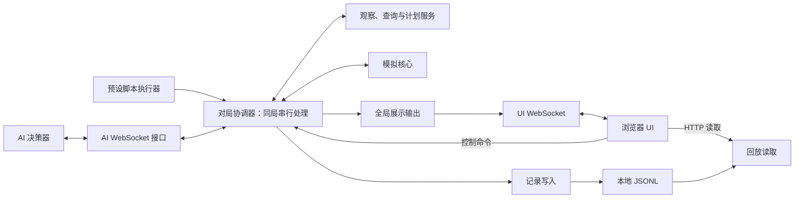
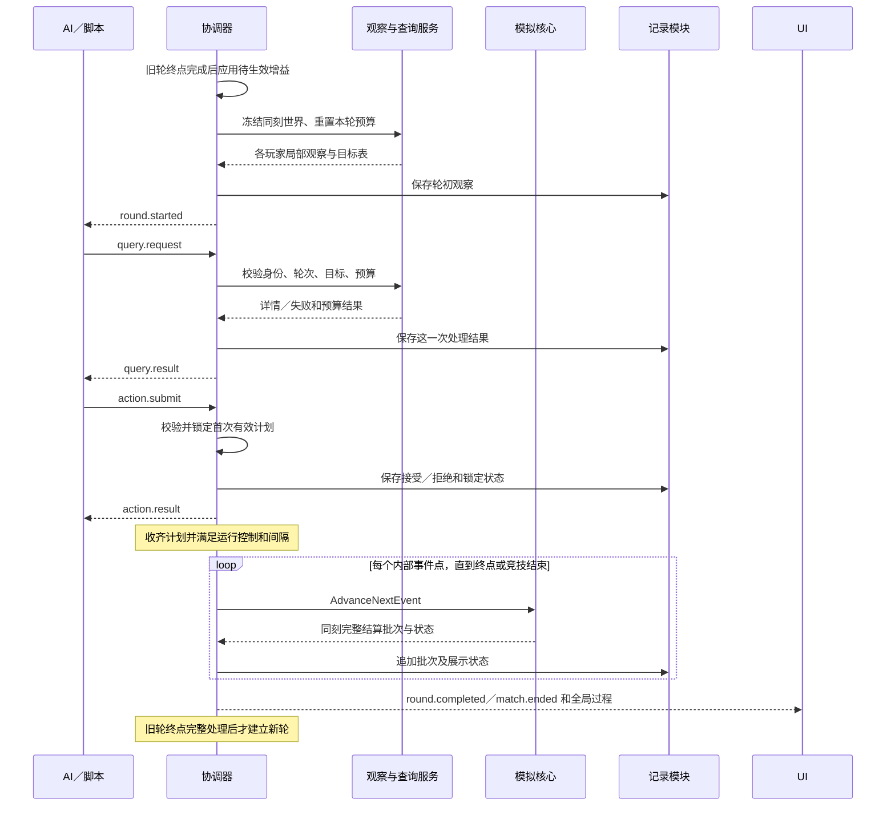

# 程序开发详细设计：第一版

日期：2026-10-13。

本文将 [已确认规则](首版模拟规则_已确认版.md) 和 [系统架构](系统架构设计_首版.md) 落实到程序模块、状态归属、接口和开发顺序。玩法以已确认规则为准；本文的目录、类名、方法名和消息名称属于实现建议，不要求逐项确认。受限 M0 已按裁剪范围实现并验收，其余完整首版模块仍按本文设计继续开发；实际情况见 M0实施与验收记录.md。

目标是尽快运行一个可以观察、暂停和单步的验证程序，再按已确认首版范围完成真实 AI 接入、信息查询、道具和记录回放。保持一个 ASP.NET Core 进程、普通 C# 模拟核心、浏览器 TypeScript＋Canvas UI；不引入微服务、数据库或通用游戏引擎。

## 1. 系统分工

| 部分 | 负责 | 不负责 |
| --- | --- | --- |
| AI Client | 接收自己的局部观察，购买额外信息，生成并提交本轮计划 | 游戏裁决、计时、绘图；首版不开发 AI 策略算法 |
| Server | 管理对局与连接，提供观察和查询，收集计划，模拟、记录并发布结果 | 代替 AI 选择策略；不依赖浏览器推进游戏 |
| UI | 全图显示已确认的过程，展示状态和日志，提交运行控制，读取记录回放 | 修改玩家属性、预测竞技结果、充当 AI 决策入口 |
| Script Runner | 执行预设请求，使用与真实 AI 相同的查询和计划服务 | 读取隐藏状态决定动作，绕过预算或裁决，实现智能算法 |



这是职责图，不要求每个方框建立项目或接口。观察与查询直接读取协调器持有的冻结世界快照；UI 控制实际经 UI WebSocket 转交协调器。

## 2. 工程组织

建议先建 Core、Server 两个运行项目，前端放在服务端目录内。按用户补充的测试规范，M0 优先运行模拟脚本并通过日志验收；仅需要有价值的独立关键验证时再建立 Tests 项目，不为工程完整性先建测试框架：

```text
QQT.sln
src/
  QQT.Core/                         普通 C# 类库
    Model/                         地图、玩家、泡泡、道具、计划、逻辑事件
    Time/                          RationalTime
    Simulation/                    GameEngine 与移动、放置、爆炸、胜负计算
  QQT.Server/                       ASP.NET Core 可执行项目
    Application/                   MatchCoordinator、GameSession、决策服务
    Transport/                     AI 与 UI WebSocket 连接
    Contracts/Ai/                  AI 请求和响应 DTO
    Contracts/Ui/                  全局展示和控制 DTO
    Persistence/                   JSONL 写入、回放读取
    Scripting/                     JSON 脚本加载和执行
    Configuration/                 每局配置读取与校验
    ClientUi/                      TypeScript 源文件、HTML、CSS
    wwwroot/                       构建后的前端静态资源
tests/
  QQT.Tests/                        可选：确有必要的独立关键验证
config/game.json
scripts/
records/
docs/
```

依赖方向为 `QQT.Server → QQT.Core`，测试可引用两者。Core 不引用 Server、ASP.NET Core、WebSocket、文件写入或前端类型。前端使用独立的展示 DTO；AI DTO 不直接序列化整个 `GameWorld`。

目录只是代码组织，不另建进程。首版不单独建立网关服务、回放服务或共享协议项目；也不为每个类建立接口。文件路径和前端构建工具在实施时确定。

## 3. Server 模块及职责

| 模块／主要类 | 输入 | 输出 | 状态归属与职责 |
| --- | --- | --- | --- |
| `GameConfigLoader` | 本局配置文件 | 校验后的 `GameConfig` | 创建时读取并固定；失败拒绝创建，不回退旧配置 |
| `MatchCoordinator` | AI、脚本、UI 命令和掉线通知 | 请求结果、模拟批次、阶段变化 | 唯一修改本局游戏与决策状态的执行者，组织以下模块 |
| `ParticipantRegistry` | 登记、连接关闭／错误 | 玩家编号、席位、连接绑定 | 准备阶段释放席位；开局后禁止恢复原局资格 |
| `ObservationBuilder` | 冻结世界、玩家 | `PlayerObservation` | 裁剪 5×5 视野，创建轮内泡泡查询编号，不附加付费字段 |
| `InformationQueryService` | 查询、身份、本轮预算与目标表 | 详情或失败、剩余行动值 | 可见性、轮次、锁定状态和预算校验；成功逐次扣费 |
| `ActionPlanService` | 动作、本轮起点和属性 | 拒绝原因或锁定计划 | 路径几何校验、首次有效提交锁定、关闭本轮查询 |
| `GameEngine` | 世界、锁定计划、待处理掉线 | 下一事件点的世界和事件批次 | 移动、阻挡、泡泡、连锁、淘汰、道具处理与胜负 |
| `RecordWriter` | 初始化、请求处理、事件批次与快照 | JSONL 追加结果 | 按处理顺序写入；失败停止进一步推进并保留现场 |
| `UiPublisher` | 已确认全局状态、事件与运行状态 | UI 消息 | 生成展示输出，不修改游戏；UI 积压不影响裁决 |
| `ReplayReader` | 记录编号、目标 tick／序号 | 已保存快照和事件 | 读取有效前缀，支持跳转，不重新运行 AI 或引擎 |
| `ScriptRunner` | 预设 JSON、当前轮局部观察 | 有序查询和动作请求 | 调用同一应用服务；缺有效计划则验证未完成 |
| `AiConnection`／`UiConnection` | WebSocket 消息 | 协调器命令、网络响应 | 负责消息收发和连接状态；不直接扣费或改地图 |

准备对局和运行对局由同一个 `GameSession` 表达。结束后保留结果供 UI 查看，人工创建下一局；一个进程最多存在一局可推进的对局。

## 4. 数据模型与状态归属

### 4.1 模拟状态：GameWorld

| 模型 | 主要字段 | 说明 |
| --- | --- | --- |
| `GameConfig` | 参赛人数（2／3／4）、逐帧推进开关、初始属性、寿命、视野、查询费用、500 tick 上限、地图参数、四类道具固定／随机分配 | 本局不可变配置；默认四人、自动推进；随机超量需求在位置耗尽后跳过，不设置游戏属性上限 |
| `GridPosition` | 整数 `X`、`Y` | JSON 为 `{"x":0,"y":0}`，表示格子，不表示细分物理位置 |
| `RationalTime` | 分子、正分母 | 精确逻辑时间，不用浮点裁决；显示时可转小数 |
| `MapState` | 21×21 地形数组 | 100 硬墙、329 初始箱子、12 初始空地；UI 外圈不在数组内 |
| `PlayerState` | 编号、存活、位置、已生效速度／容量／范围、待生效增益、在场泡泡数 | 本轮属性固定；本轮拾取累计到下一轮，初始值仍统一 |
| `MovementSegment` | 起点、终点、开始／跨线／到达时刻、进度、前进或强制回退阶段 | 跨线成功归目标格；失败仍归原格，以原速度退回刚离开的中心，取消剩余计划移动 |
| `BubbleState` | 内部编号、所属玩家、格子、实际放置时刻、预定到期 | 同格多颗分别存储；有效范围按所属玩家当轮属性计算，放置时范围仅可留作历史信息 |
| `BubbleExitPermissions` | 具体泡泡与玩家的许可关系 | 生成时已归属该格的玩家可到中心并离开，含同刻成功跨线者；尚未跨线者不预先获准进入；离开或泡泡消失后清除 |
| `CrateItemAssignments` | 箱子格 → 道具种类 | 开局固定或随机预分配，每箱最多一件；玩家观察不公开隐藏内容 |
| `ItemState` | 内部编号、格子、种类 | 三类：移速、容量、范围；箱子销毁后露出，中心批量拾取或被后续爆炸销毁 |
| `TickExecution` | 本轮起止时刻、方向、计划路径、待执行放置、移动是否终止 | 本轮执行上下文，不跨轮保留未完成计划 |
| `MatchResult` | 胜者／平局、结束时刻、原因 | 竞技结果与验证未完成、技术故障分开 |

`PlayerState` 与 `BubbleState` 保存游戏事实；GameConfig 保存初始规则配置。道具改变玩家运行时属性，不改写本局初始配置。泡泡使用所属玩家在实际爆炸轮的已生效范围，包含此前已放出的泡泡。淘汰后保留所属玩家属性供其已放泡泡计算，不将泡泡变成无归属实体。

时间值建议约分、分母为正，统一比较和运算入口。首版可以用 `long` 保存分子／分母，以 `BigInteger` 计算中间乘积、约分后检查可表示范围；不能溢出后回退浮点或四舍五入。协议仍采用分子、分母整数对象。`BigInteger` 提供任意精度整数能力，参见 [官方文档](https://learn.microsoft.com/en-us/dotnet/api/system.numerics.biginteger?view=net-10.0)。这是实现选择，不改变分数 tick 规则。

### 4.2 决策状态：RoundContext

`RoundContext` 由协调器维护，包含 `gameId`、`roundId`、逻辑时刻、深拷贝的 `FrozenWorld`、各玩家剩余行动值、可查询目标表、禁用的掉线目标、锁定计划与提交状态。建立下一轮时，先完成旧轮终点；逐帧模式须等待“tick演示”后才将待生效增益加入已生效属性并清零待生效计数，随后重置预算、冻结观察并下发，自动模式不等待按钮。

- 世界快照在本轮开始时生成，不随查询改变。
- 行动值随成功查询变化，不放进不可变世界快照。
- 泡泡轮内编号与内部泡泡编号的映射仅服务端持有。
- 等待阶段掉线，更新实际世界并禁用查询目标，保留其他玩家原快照、预算、查询结果和锁定计划，不重开该轮。
- 对局、轮次和绑定身份校验在应用服务入口完成，不能仅由前端或脚本保证。

### 4.3 运行状态：GameSession

连接表、JSONL 写入状态、最小推进间隔的现实计时、UI 暂停请求和播放控制属于运行状态，不属于模拟世界。

建议分别表达三个维度，避免一个枚举混用“等待”“暂停”“结束”：

| 维度 | 建议值 | 含义 |
| --- | --- | --- |
| 对局阶段 | `Preparing / AwaitingTick / Collecting / Simulating / Ended / Aborted` | 准备（达到配置人数后就绪）、等待演示点击、收集动作、模拟、竞技结束、验证或人工终止 |
| 运行控制 | `Running / Paused`，另有暂停请求；逐帧模式由配置固定 | “tick演示”只能从 AwaitingTick 开启一轮决策，不能在收集／模拟中积攒许可 |
| 记录状态 | `Healthy / Faulted` | 写入失败阻止进一步推进，不伪造竞技结果 |

例如“已暂停，但甲还未提交”是 `Collecting + Paused`，不等于掉线或游戏结束。逐帧模式开局后及每轮完成后进入 `AwaitingTick`，点击后才进入 `Collecting` 并下发观察；收齐后按间隔与运行控制完成本轮模拟，无需第二次点击。等待按钮时新轮尚未建立，不接受新轮查询／提交。服务端校验点击的 gameId 与待开启 roundId，重复、过期或阶段不符的点击不得开启后续轮；不因 UI 禁用按钮就省略服务端校验。

人数与出生：每局参赛人数只接受 2、3、4；从四角以种子打乱后取前 N 个，互不重复，记录实际编号到出生点映射。人数不足不允许开局，满员拒绝新登记；开局后不补位。核心循环、计划数量、观察、脚本及预期校验、池缓冲有效长度和 UI 均按实际人数处理，不为未参赛角生成假玩家或死亡事件；既有四人脚本保留兼容。

## 5. 并发与调度

采用“多入口接收、同局串行处理”。网络入口解析后提交带连接身份的命令，协调器顺序处理查询、扣费、计划锁定、运行控制和世界推进。

建议用 `System.Threading.Channels` 承载应用命令，单消费者修改 GameSession；它提供生产者／消费者传递机制，参见 [官方说明](https://learn.microsoft.com/en-us/dotnet/core/extensions/channels)。公平性仍由游戏规则实现，队列本身不提供公平决策。

- 准备阶段：串行登记、释放席位、响应 UI 开局命令，避免达到配置人数的检查与断线竞争。
- 收集阶段：世界冻结，查询与动作按实际处理顺序校验；无动作截止和心跳超时淘汰。
- 模拟阶段：协调器逐个调用引擎推进到下一事件点，不把整个 tick 当作不可检查的长函数。
- 网络关闭／错误只提交不可变通知，不直接删除玩家；模拟阶段在下一内部结算点应用通知。
- 同一个事件点开始处理时截取待处理通知批次；位置推进后应用该批掉线，再做同刻爆炸。批次处理期间新到通知留到下一结算点，避免插入半次爆炸。
- UI 暂停请求可在内部点被收取，但只在 tick 边界生效；AI 不能因此获得途中重新决策机会。
- 不用 `Task.Run` 为同刻玩家或泡泡分别裁决，不依赖遍历编号决定冲突结果。

最小推进间隔使用单调现实时间计算：后续轮开始模拟须满足“全部存活玩家有效计划已锁定、运行控制允许、距上轮实际模拟开始至少配置间隔”。逐帧模式点击只开启本轮，不绕过间隔，收齐后不要求再次点击。计时到点仅唤醒检查，不能自动补动作或越过 AwaitingTick；唤醒命令关联当前对局和轮次，旧唤醒不推进新局。

开局后在 AwaitingTick、暂停和 Collecting 收到掉线均在当前逻辑时刻淘汰并检查胜负，不等点击、不推进泡泡时间；模拟期间仍在下一个内部结算点与同刻爆炸统一处理。等待按钮掉线后若仍多人存活则继续等待，若剩一人或零人立即结束。准备阶段仅释放席位；结束／终止后的连接清理不再竞技淘汰。

每条 WebSocket 连接建议一个接收循环、一个串行发送循环。协调器提交待发送消息，不等待浏览器动画完成。官方 API 说明同一 WebSocket 支持同时一次发送和一次接收，并发多次发送需要串行化，见 [SendAsync 文档](https://learn.microsoft.com/en-us/dotnet/api/system.net.websockets.websocket.sendasync?view=net-10.0)。不设置 AI 迟交或心跳超时；消息格式错误也不直接当成连接掉线。

## 6. 一轮的具体数据流



首轮须达到本局配置人数并由 UI 手动开局：自动模式立即建立首轮观察，逐帧模式先进入 AwaitingTick，点击“tick演示”后才建立。上图的属性激活、round.started 以及后续过程都在该门槛之后执行；逐帧模式每轮完成后返回 AwaitingTick。常规轮先完成旧轮终点事件，新轮才开始；旧轮终点放置和新轮起点放置可处于同一逻辑时刻，但属于不同计划，不能重复执行旧轮请求。

建议查询和计划处理以“状态变化＋响应数据”为一个应用处理结果，写入记录成功后才发布成功响应；记录失败按已确认故障规则停止运行。若内存已处理该请求，保留现场，不重执行或回滚重试来恢复同局。

## 7. 模拟核心内部模块

Core 内先使用普通具体类和纯计算辅助函数，不引入 ECS 或任意插件框架。

| 内部模块 | 职责与边界 |
| --- | --- |
| `InitialWorldFactory` | 按配置建立地图、生成四角分配及箱内道具分配，使用种子并记录实际结果 |
| `EventTimeCalculator` | 寻找下一到期、跨线检查、中心到达、回退到中心、轮末等时刻；只选择时刻，不自行裁决 |
| `MovementResolver` | 推进质点位置，按事件处理前环境统一检查跨线与归属；失败取消剩余计划，以原速度强制退回刚离开的中心 |
| `BubblePlacementResolver` | 按实际到达中心尝试放置、检查容量、建立离开许可和预定到期 |
| `ExplosionResolver` | 读取各所属玩家当轮已生效范围，从同一爆炸前地图计算全部到期与连锁闭包，返回覆盖、泡泡、箱子和原有露出道具集合 |
| `EliminationResolver` | 合并掉线与受击淘汰，取消未执行计划，保留已放泡泡 |
| `OutcomeResolver` | 同批淘汰后立即判剩余人数；处理第 500 tick 终点平局 |
| `ItemResolver` | 释放箱内道具、销毁覆盖内原有道具、中心批量拾取、累计待生效增益、轮初激活属性；不改本轮计划 |
| `GameEngine` | 组织以上计算并返回一次完整结算批次，不访问网络、文件或现实计时 |

建议核心调用边界：

```text
BeginTick(world, lockedPlans) → 起点执行上下文及起点批次
AdvanceNextEvent(world, execution, pendingDisconnects)
    → SimulationBatch(time, events, state, tickCompleted, matchResult)
ResolveDisconnectAtCurrentTime(world, disconnectedPlayers)
    → 当前边界的淘汰批次与结果，不推进逻辑时间
```

该签名表示职责，不是已经实现的 API。引擎在一次调用内完成一个同刻批次，不能把“先炸一颗泡泡”的半成品状态发布到 UI 或用于检查胜负。

等待决策时掉线由协调器调用当前时刻结算入口，仍复用核心的淘汰与胜负逻辑；只在准备阶段由登记模块释放席位。等待阶段结算后，协调器保留其他人的原 RoundContext，并禁用掉线目标，不能为了更新世界而重新发放观察或行动值。

### 7.1 包含道具的结算顺序

1. 根据下一事件时刻推进全部玩家位置；对该时刻准备跨线者，统一按本批处理前的障碍检查进入，成功归新格，失败保留原格并安排强制回退。已启动但未跨线不保证完成，本批稍后移除障碍也不改判本次失败。
2. 应用本结算点待处理掉线，取消其尚未执行的计划。
3. 冻结本批爆炸前地形、泡泡、当轮已生效范围和露出道具视图；一次计算全部到期、叠放连锁和传播连锁。
4. 统一移除已炸泡泡、销毁箱子和覆盖内原有露出道具、释放容量；从被毁箱子释放预分配道具，新掉落者不被本批爆炸销毁。按同刻中心所属格受击并合并淘汰。
5. 立即检查竞技结果，结束即返回，取消之后同刻放置与移动。
6. 收集存活玩家在该时刻的中心到达，按道具统一计算全部获得者，向每人累计待生效增益，再移除已拾取道具。
7. 统一处理存活玩家实际到达中心的放置请求，使用本轮已生效容量；失败只影响当次。
8. 按本轮已生效速度继续计划移动或强制回退；未遇阻的中心到达者可启动下一段，到准备跨线时再检查阻挡；已遇阻者回到刚离开的中心后等待。
9. 若到轮末，完成旧计划终点事件并返回；第 500 轮仍多人时，终点放置后判平，不开启下一轮。

开始下一轮前再统一激活待生效增益。旧轮终点那批爆炸使用旧范围，即使该物理时刻同时是下一轮起点，也不重复结算旧爆炸。记录用轮次、阶段和 sequence 区分同一逻辑时刻的旧轮终点与新轮属性激活。

范围为 1 的泡泡覆盖自身及四方向；硬墙不覆盖、箱子覆盖后停止，泡泡触发连锁且原射线继续。推进到同刻时，成功跨线的半程当刻归目标格；跨线失败的边界当刻和回退全程仍归原格。不能简单用全局坐标向下取整替代方向和跨线成败相关判定。

规则依据已于 2026-10-16 更新，含强制回退三条约束及同刻结果表，见 [首版规则](首版模拟规则_已确认版.md#移动与阻挡)。精确时间、跨线检查与强制回退的职责现已在 GameSimulation 内实现，类拆分仍是设计建议；道具已于 2026-10-17 实施，见 [道具验收记录](items/道具实施与验收记录.md)；正式掉线接入等仍未实施。实际范围见 [精确时间验收记录](精确时间实施与验收记录.md)。

### 7.2 事件查找与边界重复

首版规模下，直接扫描存活移动段和在场泡泡寻找最早时刻即可；每次重新计算候选，避免提前为整轮生成全部放置和爆炸事件。待性能数据有需要再引入优先队列，不为未到达位置预先生成泡泡。

同刻事件合成一个批次。已经爆炸的泡泡在世界中移除，不会在原预定到期再次引爆。移动段记录开始、跨线与到达时刻以及前进／回退阶段，放置请求记录执行／跳过状态；回退到中心不重新执行已处理过的请求，也不重试容量不足等失败请求；轮初与旧轮终点使用明确执行阶段，避免同一个边界重复执行旧计划。

当所有人等待且没有泡泡等内部事件时，直接推进到轮末，不能等待一个不存在的移动事件。最后一人获胜时返回实际结束时刻，不补模拟剩余轮长。

## 8. 观察、查询和动作校验

### 8.1 分开 AI 与 UI 数据

`PlayerObservation` 包含本轮可见格子及实体、自身免费状态和对局／轮次／逻辑时刻。`participantIds` 仅列视野外其他玩家稳定编号，视野内其他玩家放入 `visible.players` 并免费附位置，两者不重复且不含自身。视野外地形及实体位置不免费发送；未发送不等于空地。可见泡泡只有位置和轮内查询编号。

`UiWorldSnapshot` 包含全图、所有玩家与泡泡状态、道具状态和全局事件。两类 DTO 与映射函数分别定义，不使用“全局 DTO 加 hideFields 标记”的方式生成 AI 观察，避免遗漏裁剪。

玩家免费观察增加视野内已露出道具的位置、类型和效果，不发送箱子隐藏内容。其他玩家付费详情统一为七项：唯一编号、位置、速度、泡泡容量上限、泡泡火力、视野宽度、在场泡泡数；允许查询视野外玩家且包含其位置。视野内每次成功 2 点，视野外 3 点，不增加剩余行动值或道具明细。泡泡付费范围由 FrozenWorld 中所属玩家的当轮已生效范围生成；未来新获得增益仍可能改变未来爆炸范围，查询不承诺永久固定。

### 8.2 查询处理

处理顺序建议为：绑定身份 → gameId／roundId → 对局收集阶段及未锁定 → 本轮可查目标且未禁用 → 按本轮冻结可见性确定费用 → 预算足够 → 扣费并形成详情。泡泡仅允许本轮可见目标，单价 1；玩家允许视野内外目标，单价分别为 2 和 3。失败不扣费、不返回详情；成功响应同时返回自己剩余行动值。

每次接收并成功处理一条查询都产生独立记录序号，即使 requestId 相同也收费；不以 requestId 做成功查询缓存或唯一键。客户端用 requestId 关联响应，服务端记录序号区分重复处理。

### 8.3 动作处理

动作由方向／等待和坐标对象列表组成，服务端根据本轮起点、速度构成名义直线路径。校验路径归属，不把路径上的未知箱子或泡泡造成的执行截停作为计划无效；几何校验不扫描隐藏地形并披露阻挡明细。

首次有效提交保存完整计划并锁定，关闭该玩家本轮查询。后续提交只返回已有锁定状态，不执行新计划或替换；不能把查询的逐次处理规则套到动作上。坐标重复或越界等边界校验采用满足现有每轮每中心最多一颗限制的简单方案；若需要定义新的玩法语义，再确认。

## 9. 通信接口草案

以下路径和名称为建议，用于明确模块交接，不是新的玩法规则。首版都在本机服务端上。

| 通道 | 建议接口 | 用途 |
| --- | --- | --- |
| AI WebSocket | `/ws/ai` | 登记、局部观察、查询与决策、掉线和结束通知 |
| UI WebSocket | `/ws/ui` | 全局状态、事件、准备信息、创建／开始／tick演示／暂停／继续／终止控制 |
| HTTP | `/` 与静态资源 | 加载浏览器页面 |
| HTTP | `/api/scripts` | 预设脚本列表，供创建界面选择 |
| HTTP | `/api/replays`、`/api/replays/{recordId}` | 回放列表、有效记录数据；按 tick 读取可加参数 |
| HTTP | `/api/replays/{recordId}/events?afterSequence=...` | 读取已保存日志，补齐跳过动画期间的事件 |

UI 控制仍走 UI WebSocket，HTTP 回放读取不修改真实对局。浏览器重开页面可重新订阅全局状态；这不是 AI 重连，不恢复出局参赛资格。首版本机 UI 接口不校验凭据。

### 9.1 建议消息模型

AI 查询与动作固定携带已确认的 gameId、roundId、requestId，新增 `type` 和 `payload` 用于分发。建议 gameId、requestId 为字符串，roundId 为从 1 开始的整数；首轮起始逻辑时刻为 0。连接绑定身份不由请求 payload 的 playerId 覆盖。

```json
{
  "type": "action.submit",
  "gameId": "match-example",
  "roundId": 1,
  "requestId": "request-001",
  "payload": {
    "direction": "right",
    "placements": [{ "x": 1, "y": 0 }]
  }
}
```

示例是在首版速度 1 格/tick 下，从 A1 向 B1 移动并选择 B1 放置。方向可用 `up/down/left/right/wait`；等待只允许选择当前格作为放置位置。

| AI 消息 | 方向 | 内容 |
| --- | --- | --- |
| `participant.register / participant.registered` | 双向请求／响应 | 申请登记，返回服务端分配编号和准备状态；登记前不要求尚未建立的 roundId |
| `round.started` | Server → AI | gameId、roundId、精确逻辑时刻、自己的局部观察和本轮额度 |
| `query.request / query.result` | 双向请求／响应 | bubble／player 目标、详情或失败、剩余行动值 |
| `action.submit / action.result` | 双向请求／响应 | 计划，整份拒绝原因或锁定确认 |
| `participant.eliminated` | Server → AI | 淘汰通知；等待阶段掉线编号通知按已确认范围发布 |
| `match.ended` | Server → AI | 已确定结果，随后关闭参赛连接 |

其他玩家的淘汰位置、炸到谁的泡泡详情等，不通过通用 AI 广播泄露。AI 的额外执行反馈也需遵守已确认信息范围；完整执行记录供 UI／对局记录查看。无效请求返回结构化错误，不作为连接错误判掉线。

UI 消息建议使用 `session.snapshot`、`round.completed`、`match.ended`、`runtime.error` 和 `control.result`。快照增加配置人数、已登记席位、逐帧开关、是否可点击和待开启轮次；“tick演示”命令建议为 `tick.demonstrate`，带 gameId、待开启 roundId 和 requestId，服务端按阶段串行校验。每轮完成消息包含 roundId、起止逻辑时刻、终点全局状态、移动段和离散事件；便于动画直接表达服务端已确认的过程。途中结束时终点为实际结束时刻。

## 10. 道具模块设计：已补充确认

首期四种道具已纳入设计：速度 +1 格/tick、同时在场泡泡容量 +1 颗、每方向爆炸范围 +1 格、视野半径 R +1 格（5×5 → 7×7）。2026-10-17 确认本次实现四类道具、局部观察计算与脚本验证，UI 展示属性；真实 AI 接入另做。当前实施计划见 [道具需求与实施计划](items/道具需求与实施计划.md)。

当前实现由 `GameSimulation.Items.cs` 承担道具创建、拾取与属性变化，`PrepareRound` 激活增益，`PlayerObservation` 生成独立持有池缓冲的局部观察；未为当前规模拆出通用框架。以下 `ItemResolver` 等名称仍表示完整首版的职责设计。程序层面由 `ItemResolver` 负责道具创建、拾取与属性变化，产生可记录的道具事件；`ObservationBuilder` 决定 AI 可见字段，UI 显示全量状态，RecordWriter 保存实际处理结果。属性增加通过统一入口更新 PlayerState，不让网络或前端直接改值。

| 已确认规则 | 模块落实 |
| --- | --- |
| 支持固定位置数组或各类型随机数量配置，开局藏入不同箱子，破坏后露出；位置不足时跳过剩余需求 | GameConfig、InitialWorldFactory、CrateItemAssignments、ItemResolver |
| 到达中心拾取，同刻玩家都获得同一道具增益 | ItemResolver 先建立“道具 → 全部存活到达者”集合，再发放并移除 |
| 属性下一 tick 生效，本轮提交和运动不受影响 | PlayerState 区分 EffectiveAttributes 与 PendingItemGains；TickExecution 保存本轮属性 |
| 旧轮终点仍用旧属性，处理完后应用增益再生成观察 | MatchCoordinator 在旧轮完成与新 RoundContext 建立之间激活 |
| 增益持续到局末、可累积且无上限 | 不设置道具增益的游戏上限或过期事件 |
| 已放泡泡也使用实际爆炸轮的已生效范围 | ExplosionResolver 从所属玩家读取本轮属性；不使用固定 RangeAtPlacement 裁决 |
| 视野内免费显示位置和类型，隐藏内容不公开 | ObservationBuilder 单独投影 GroundItems |
| 原有露出道具可被炸毁，同批箱子新掉落者保留 | 爆炸前快照确定待销毁道具，清理后才从箱内映射生成露出实体 |

配置设计更新为固定／随机两种模式：固定模式提供位置、类型数组；随机模式提供 speed、capacity、range、vision 各类型非负数量及可选种子。随机需求总和可以超过箱子数量，位置不足时跳过剩余需求。各类初始数量尚未指定，不能把实现示例说成已确认默认值。具体字段与兼容策略见当前实施计划。

随机分配：固定枚举箱子位置并做有种子的 Fisher–Yates 洗牌，逐个从四类剩余需求中按数量加权抽取类型，直至需求满足或箱子耗尽。箱子足够时精确满足各类型数量；不足时不按类型配置顺序优先分配。只保存四类剩余计数，不按请求总数创建类型列表；数量求和使用足够宽的整数。记录种子、实际分配、各类型实际数量与跳过数量；未来回放读取实际结果，不重新抽取。

例如甲在第 k 轮拾取范围增益，原有泡泡 B 尚未爆炸：第 k 轮的到期或连锁（含终点）仍按旧范围；第 k+1 轮观察中 B 的范围已提高，之后在该轮爆炸／连锁也用新范围。本轮拾取容量增益，不能提前满足本轮放置容量；移速增益也不延长本轮路径。

## 11. 记录与回放

建议每局 JSONL 使用递增 `sequence`，一条完整 JSON 行为一个可读取单元。每次应用请求处理分别追加记录，同一逻辑事件点用一条 `simulation.batch` 保存完整同刻结果，避免有效前缀只保存了半次连锁。

| 记录类型 | 内容 |
| --- | --- |
| `match.created` | 配置、固定地图、随机种子、各类型数量与实际箱内道具分配、记录格式版本 |
| `match.started` | 实际玩家和出生分配、初始全局快照 |
| `round.started` | 本轮时刻、各 AI 实际观察、初始行动值 |
| `query.processed` | 原请求、完整结果／错误、费用、剩余预算；重复也独立记录 |
| `action.processed` | 原请求、接受／拒绝、锁定状态和计划 |
| `simulation.batch` | 精确时刻、移动／放置／爆炸／淘汰／道具露出、销毁、批量拾取事件及本批状态；爆炸保存实际使用的范围 |
| `round.completed` | 轮次、起止时刻、本轮轨迹和终点状态 |
| `attributes.activated` | 旧轮终点完成后激活的增益、所属新轮次与更新后的状态 |
| `runtime.changed` | 控制、掉线生效、错误与验证未完成信息 |
| `match.ended / match.aborted` | 竞技结果或未完成原因，二者不混用 |

首版建议保存每批完成后的全局快照，回放无需重跑引擎。ReplayReader 读取时构建内存 tick 索引，定位到对应边界快照和事件；暂不建立索引数据库。跳转定义为显示目标 tick 已保存终点，初始状态可记为 tick 0；未保存完整终点的部分仍可按已保存批次展示，并标记未完成。

记录解析只接受连续、完整、可识别的前缀，遇到损坏／不完整尾行停止，不猜测结果或跳过中间损坏继续拼接。写入失败停止进一步推进，保留内存现场和已写数据，不重试重执行查询来恢复；未结束的故障对局人工终止后新开。若竞技结果已形成，存储错误不改判已有结果，记录可标不完整。

结束／终止状态先固定，再清理连接，避免程序关闭连接触发新的竞技淘汰。掉线记录保存实际生效的逻辑时刻，回放不依赖之后的网络时序。

## 12. UI 模块

| 前端模块 | 职责 |
| --- | --- |
| `UiConnection` | 连接独立 UI 通道、提交控制、维护订阅状态 |
| `LiveViewStore` | 保存最新服务端状态、准备信息、结果和待播放轮 |
| `TimelinePlayer` | 按每 tick 1 秒展示已保存移动段与事件，不调用游戏规则 |
| `MapRenderer` | 绘制 21×21 地图及额外外圈、玩家、泡泡、道具、爆炸效果 |
| `ControlPanel` | 脚本／真实 AI 模式、创建、实际准备席位、开始；逐帧配置开启时显示“tick演示”；完整首版的暂停、继续独立提供 |
| `EventLogView` | 展示完整日志和错误，按服务端序号追加，不因跳过动画丢事件 |
| `ReplayController` | 加载记录、固定 1 倍播放、暂停、前后逐 tick 和跳转 |

首版可以用一个页面实现，无需页面路由框架。LiveViewStore 和 ReplayController 的数据来源分开，但复用 renderer 和 timeline；回放暂停不能向真实对局发送暂停命令。

正常时按逻辑时刻比例播放。积压计数只包含已完成、未开始播放的轮，达到 2 轮跳到最新完整状态并清空旧动画队列；日志按 sequence 补齐，不清除记录。断开或重新订阅后的状态刷新同样只更新展示，不修改游戏。

先用简单几何图形表达角色和泡泡，道具用四种不同标识即可；爆炸效果纯视觉，不产生持续危险区。前端 `requestAnimationFrame`、展示小数和 UI 动画结束都不参与游戏裁决。

## 13. 开发顺序和完成标准

用户进一步提出先完成“四人相邻格放泡泡后撤到安全格”的最小场景。可在下列完整首版阶段前先做 M0，具体必须项、暂缓项和四轮验收见 [最小验证程序 M0 范围评估](最小验证程序_M0范围评估.md)。该评估建议首次可运行交付暂缓持久化、暂停／单步和正式 AI 通道，不永久删除后续首版需求。

| 阶段 | 交付 | 完成标准 |
| --- | --- | --- |
| A：核心可执行 | 数据模型、分数时间、地图、移动、泡泡、爆炸、淘汰、胜负 | 直接推进预设计划，覆盖已确认时间和同刻规则，输出轨迹与事件 |
| B：第一个能动的验证程序 | ASP.NET Core、脚本服务、配置、全局 UI、日志、暂停控制 | 从 UI 选择脚本开局，能看到移动和爆炸；逐帧门槛按更新后的阶段 C 实施 |
| C：信息和真实接入 | 2／3／4 人配置与随机出生、观察、收费、锁定、登记与 AI WebSocket、独立 UI 通道、逐帧开关 | 达到配置人数后手动开始；逐帧点击才发观察，一次最多一轮；付费与重复规则正确，开局后所有阶段掉线淘汰 |
| D：道具与记录回放完成 | 按已补充规则落实 ItemResolver，完善 JSONL 和回放 | 四种道具实际生效，已放泡泡动态范围与视野裁剪正确，回放与保存过程一致，故障处理符合约定 |

记录基础写入应从阶段 B 就接入，不能等回放阶段才记录验证过程。阶段 D 完善回放和完整性检查。阶段顺序用于尽快获得可运行结果，不把道具、真实 AI 接口或回放移出首版范围。

测试规范以项目 AGENTS.md 为准：实际运行脚本并核对日志可作为最终验收目标；不要求以下每项各写独立测试。仅在相关功能已经实现、脚本不足以区分关键错误或需要故障回归时，从以下情况选择最少且有意义的验证：

- 成功跨线归目标格、失败边界与回退归原格、高速不穿墙、途中到期仅按当时位置受击。
- 同刻连锁使用旧地图，不能因先炸毁箱子让同刻射线穿透；全批淘汰后才判胜负。
- 同格叠放、离开许可、跨线前障碍消失可通过、同刻移除仍阻挡、强制回退及回中心不重试放置。
- 两个同时查询竞争最后行动值时只有预算足够的处理成功；查询重发再收费，动作重发不执行。
- 等待冻结、掉线合并、准备释放席位、锁定后查询拒绝以及第 500 tick 终点顺序。
- 记录故障不制造胜负，未完成回放只显示有效前缀；实时跳过动画但日志完整。

脚本测试不能替代真实 WebSocket 验证。前者证明规则与应用服务；后者验证连接绑定、消息收发和关闭通知。道具需覆盖配置数量与种子复现、同刻多人拾取、旧轮终点旧属性、下一轮变速与增容、已放泡泡范围更新，以及原有道具销毁／新掉落保留。

## 14. 第一版设计的关键结论

Server 的核心是 `MatchCoordinator + GameEngine`：前者唯一维护对局与决策状态，后者按精确时刻裁决。网络、UI、记录和脚本通过明确的数据边界接入，不各自复制游戏规则。

第一步优先实现“脚本输入 → 同一套应用处理 → 核心事件 → 全局 UI”，并从一开始记录过程。普通实现细节采用以上建议继续推进；道具的生成、拾取、生效边界、动态范围与可见性已经确认，实际类型数量由配置明确提供。
