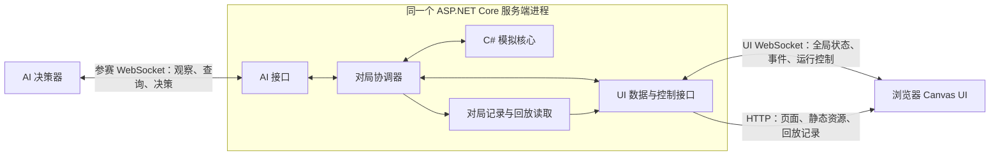

# 首版系统架构设计

本文落实已确认的技术组合与模块关系，规则以 [首版模拟规则](首版模拟规则_已确认版.md) 为准，文档导航见 [文档索引](README.md)。本文是完整首版设计；受限 M0 已实现并运行验收，实际范围见 M0实施与验收记录.md，其余首版模块尚未完成。

开发模块、状态模型、接口草案和阶段交付见 [程序开发详细设计：第一版](程序开发详细设计_第一版.md)。该文中的类名、接口路径和消息名称是实现建议；道具机制已补充确认，配置数量和其他可修改细节在实施时完善。

## 已确认的技术与交付范围

| 部分 | 技术或范围 |
| --- | --- |
| 游戏模拟核心 | 普通 C# 代码，独立于 Web 和 UI |
| 运行框架 | .NET 10 LTS，目标框架 net10.0 |
| 服务端宿主、AI 接口和 UI 后端 | 同一个 ASP.NET Core 服务端进程 |
| AI 通信 | 原生 WebSocket＋JSON，每名 AI 一条参赛长连接 |
| UI 通信 | 独立 WebSocket＋JSON 承载实时展示与运行控制；HTTP 提供页面资源与回放读取 |
| 浏览器画面 | Canvas 2D |
| 前端逻辑与控件 | 原生 TypeScript，配合 HTML/CSS；编译后由浏览器执行 JavaScript |
| 前端资源提供 | 由该 ASP.NET Core 服务端提供页面与静态资源 |
| 初版运行规模 | Windows 本机运行与验收，每进程同时 1 局，可连续多局，每局 4 名 AI |
| UI 展示 | 全局游戏状态与事件日志，实时控制与记录回放 |
| AI 客户端 | 独立决策器，首版不实现算法客户端 |
| 首期道具 | 三类各 +1；按配置数量开局藏入箱子，中心拾取，同刻到达者都获得；旧轮终点处理后下一轮生效，持续到局末且无上限；已放泡泡也使用当轮已生效范围 |
| 无 AI 算法时的验证 | JSON 脚本按轮组织有序请求，创建时加载并校验结构，UI 展示并保存记录 |
| 验证对局创建与启动 | UI 选择脚本、可选指定种子，手动开始；结束保留结果，下一局手动开始 |
| 实时推进节奏 | 最小间隔初始 1 秒，可配置；从上一轮实际开始模拟计时，收齐有效计划且间隔已到才推进 |
| 正常动画与回放 1 倍速 | 基准时长初始 1 秒／逻辑 tick，独立于服务端推进间隔配置 |
| 回放倍率 | 固定 1 倍，首版不提供倍速选择 |
| 游戏配置 | JSON，每局创建时读取并固定；文件修改仅影响新局，实际配置写入记录 |
| 对局记录 | 服务端本地目录，每局一个 JSONL 文件，进行中逐条追加，结束保留 |
| 脚本缺有效计划 | 结束验证、标记未完成，保留现场与记录，不判竞技输赢 |
| 记录写入失败 | 停止进一步 tick 推进，UI 报错，保留现场与已写记录，不因此改判胜负 |
| 配置读取／校验失败 | 拒绝新局并报具体原因，修正后重试，不回退默认值或旧配置 |
| 未完成记录回放 | 允许播放已保存的完整有效前缀，标未完成，不补模拟或推断缺失胜负 |
| 记录故障后恢复 | 首版不恢复同局；人工结束未完成运行，修复后新开 |
| UI 播放积压 | 未开始播放的模拟轮达到 2 轮时追赶最新完整状态；当前播放轮不计，完整日志与记录保留，阈值可配置 |

首版已确认 Windows＋.NET 10 LTS，以及分别采用 WebSocket＋JSON 的 AI 和 UI 独立接口；HTTP 提供 UI 资源与回放读取。构建工具、具体消息字段与接口路径尚待设计。已核对本机装有 SDK 10.0.103，官方支持 .NET 10 至 2028-11-14，参见 [.NET 支持策略](https://dotnet.microsoft.com/en-us/platform/support/policy/dotnet-core)。SDK 与运行时的具体补丁版本在实施时确定，不将本机当前补丁号视为最新版本。

## 模块与依赖

以下是实现时的职责划分，不要求每个模块都建立独立项目或进程。

| 模块 | 输入与输出 | 职责 |
| --- | --- | --- |
| 模拟核心 | 当前局状态、锁定计划、待处理掉线事件 → 新状态与逻辑事件 | 精确分数时间、移动段、阻挡、放置、到期、连锁、淘汰与胜负 |
| 对局协调器 | AI 请求和 UI 运行命令 → 请求结果、模拟推进和展示输出 | 控制决策轮、等待与暂停，按顺序验证和锁定计划，组织模拟及记录 |
| 观察与查询 | 冻结局状态、玩家身份和本轮预算 → 局部观察及付费响应 | 裁剪视野、分配轮内泡泡编号、查询目标校验、扣费与提交后关闭查询 |
| AI 接口 | 网络连接和请求 → 协调器命令及 AI 响应 | 连接身份、轮次关联、消息解析，以及明确关闭／连接错误的掉线通知 |
| UI 后端 | 全局模拟输出、UI 控制与记录读取请求 → UI 数据 | 提供全局状态、事件日志、暂停／继续／单步和回放数据 |
| 记录模块 | 初始化、观察、查询、计划、模拟事件和掉线生效时刻 → 对局记录 | 保存实际处理过程，回放读取已有记录 |
| 浏览器前端 | 服务端状态与事件、回放记录 → 画面与控件 | Canvas 绘图，位置插值、动画、全局状态与日志、回放时间轴 |

同一局状态由一个串行执行流程修改。网络入口先提交命令，由协调器处理；浏览器与网络回调不直接修改地图、玩家或泡泡。多个网络请求即使并发到达，也不能并发裁决同一玩家的行动值或计划锁定。

模拟核心不依赖 HTTP、连接对象、Canvas、页面刷新频率或现实毫秒。首版通过预设脚本驱动验证，各玩家的查询和动作输入经过服务端同一套扣费、校验、锁定与模拟规则，UI 展示结果并保存于对局记录。该工具不包含 AI 策略算法，也不绕过已确认裁决。

在 UI 选择 JSON 预设脚本、可选指定种子，手动创建／开始。脚本按模拟轮组织各玩家的有序请求，创建时加载并校验结构，具体字段待设计。结束后保留结果，下一局手动开始。UI 不逐轮代替 AI 输入；WebSocket 消息与连接仍需接口验证，不能仅凭脚本运行证明网络实现正确。

对局仍进行但本轮脚本执行完仍缺存活玩家有效计划时，包括提前耗尽，结束本次验证并标记脚本错误／未完成，保留现场与记录，不判竞技输赢，修正后新开一局。验证停止需与正常竞技胜负区分，不能在清理验证参与者时通过掉线规则制造胜负。正式 AI 在线未提交仍继续等待。

## 游戏配置与记录

游戏数值配置采用 JSON。每局创建时读取、校验并固定为本局配置，对局进行中的文件修改只影响之后新建的对局。实际生效配置随地图和种子保存于该局记录，回放不使用新局配置重新裁决旧对局。

读取失败、JSON 错误或参数不合法时，拒绝创建并在 UI 显示原因，修正后重试，不静默使用默认值或旧配置。

服务端本地目录每局一个 JSONL 文件，每行一条 JSON 记录，进行中逐条追加，结束保留，UI 通过 HTTP 选择记录回放。具体字段与目录待设计。

对局进行中写入失败时停止进一步 tick 推进，在 UI 报错并保留现场与已写记录，不因存储故障改判竞技胜负。首版不支持故障后同局恢复：暂停且未结束时，由人工终止本次运行并标未完成，不判竞技输赢，修复后新开。终止运行应先标记非竞技停止，再清理参与者，避免清理连接制造虚假胜负。

未完成记录允许回放已保存的完整有效前缀，明确标记未完成，不补模拟、不推断缺失胜负。回放反映已保存的数据，不能把未完成当作竞技平局。

## AI 通信与决策数据流

每名 AI 使用一条原生 WebSocket 参赛长连接，通过自定义 JSON 消息接收决策开始信号与局部观察、发送付费查询并接收响应、提交计划并接收锁定确认。服务端登记时分配玩家编号并绑定连接，编号在本局跨轮稳定；后续请求只能操作绑定玩家。具体登记消息与其他消息字段在实施时完善。UI 的实时数据与控制使用另一个独立 WebSocket 接口，资源与回放读取使用 HTTP。

AI 查询和动作请求均携带 gameId、roundId、requestId。对局或轮次不匹配时拒绝，不扣行动值、不锁定计划；requestId 用于关联响应，不改变查询重发成功仍扣费和动作重发不重复执行的规则。格子坐标采用 {"x":0,"y":0} 对象形式；沿途放置计划提交格子坐标对象列表，由服务端校验路径归属并按实际到达中心执行，不使用沿途格数列表。

真实 AI 对局在准备阶段接受登记，四名 AI 均登记完成后，由 UI 手动开始，再统一下发首轮观察；不足四人时保持准备。准备阶段连接明确关闭或报错时释放席位，允许新连接登记；开局后的连接关闭或错误才按掉线出局规则处理，不启用心跳超时检测，不支持重连恢复本局参赛资格。脚本验证沿用 UI 手动创建／开始流程。

席位已满时拒绝额外登记并返回“席位已满”，不设候补队列；已有席位释放后可重新申请。一局结束后先发送结束通知，再关闭 AI 参赛连接；下一局重新连接、登记并分配编号。结束后的连接清理不再触发本局竞技淘汰或改判结果。

首版本机 UI 全局数据、运行控制及对局记录读取接口不校验访问凭据。UI 接口与 AI 接口的职责、消息和连接保持独立。

1. 服务端完成旧轮终点事件，确认对局仍继续。
2. 统一应用上一轮道具待生效增益，再为本轮恢复行动值，冻结世界状态，生成各玩家的局部观察。
3. AI 接口下发决策开始信息及观察。世界逻辑时间保持冻结。
4. 未锁定的 AI 可查询本轮可见目标；查询读取同一快照，成功逐次扣费，失败不扣费。
5. AI 提交方向和沿途放置计划。无效计划整份拒绝并允许修正；首份有效计划锁定，关闭该玩家本轮查询。
6. 未收齐存活玩家计划则等待；收齐后，还须满足服务端配置的最小 tick 推进间隔，再按运行／暂停或单步控制决定推进。
7. 模拟核心推进至该轮终点或途中对局结束，产生全局状态与带逻辑时刻的事件，并写入记录。

AI 的局部观察和 UI 的全局状态是两份不同用途的数据输出。泡泡详情的收费规则仅约束 AI 查询，不约束 UI 展示。

## 事件、暂停与掉线

内部模拟按事件时刻分段推进，使用精确分数 tick，不以浏览器绘制帧作为游戏模拟步。分数时间对外采用分子、分母整数对象；整数对坐标和既有中心格受击规则保持不变。

每个结算点依次推进位置、处理待处理掉线并取消其未执行计划、结算同刻到期与连锁、统一清理并合并淘汰、检查胜负，然后对存活者统一拾取、放置和检查下一移动段。爆炸销毁已露出道具，同批被毁箱子新掉落者保留。拾取只累计待生效增益，旧轮终点处理后才应用并建立下一轮观察；胜负结束后立即停止。

运行／暂停是对局协调器的控制状态。暂停在 tick 边界生效；单步仍须收齐有效计划，最多推进一个 tick，途中结束则不继续补足。UI 控制不能替代 AI 动作或撤销锁定计划。

首版优先实时观战，最小 tick 推进间隔初始为 1 秒，可配置，由服务端协调器按相邻两轮实际开始模拟的现实时间安排。首轮收齐有效计划且允许运行即可开始；后续须收齐有效计划，且距离上一轮实际开始已满足间隔，才允许推进。计算本身可先完成，间隔控制下一轮的最早开始时刻。AI 未提交仍继续等待，实际间隔可以更长，不因间隔到达自动代走或淘汰。

不等待 UI 播放完成回执，浏览器帧率与连接状态不决定模拟 tick。模拟核心仍仅使用精确逻辑时间裁决，现实间隔不改变速度、寿命和胜负。UI 出现播放积压时追赶到最新完整状态，不因显示滞后暂停模拟。

对局开始后，仅 AI 参赛连接明确关闭或发生连接错误才产生玩家掉线通知，不加心跳超时检测，不支持重连恢复本局参赛资格。等待决策时在当前时刻处理出局；正在模拟时在下一个内部结算点处理。准备阶段同类连接事件只释放席位并接受新登记。UI 页面连接与 AI 参赛连接分别处理，关闭 UI 不构成玩家掉线。

等待期间掉线后保留其他玩家原观察、查询结果、剩余行动值与锁定计划，通知掉线编号并禁用该玩家查询。已放泡泡保留。记录同时保存掉线实际生效的逻辑时刻，使回放不依赖新一次网络关闭的现实时间。

## UI 展示与回放

实时模式通过 UI WebSocket＋JSON 接收全局状态和带逻辑时刻的事件，并通过同一 UI 通道提交暂停／继续／单步控制；HTTP 提供页面、静态资源与回放记录读取。AI 参赛与 UI 使用独立接口和连接，关闭 UI 不淘汰玩家。浏览器只对服务端已经确认的移动段和事件播放动画，移动可插值；泡泡生成、爆炸、死亡、箱子销毁等离散事件按记录的时刻切换。碰撞、容量、受击和胜负只由模拟核心裁决。显示插值使用的近似小数不参与规则运算。

首版页面展示完整地图、所有玩家状态、泡泡详情和事件日志，提供暂停／继续与按 tick 单步。不做单个 AI 的详细分析面板；各 AI 的观察、查询、扣费与决策仍保存于记录，供详细分析。

回放模式读取保存的初始配置与地图、种子、观察、查询及响应、决策、模拟事件与掉线时刻。支持播放／暂停、前后逐 tick 查看和时间轴跳转；不请求 AI 新动作，不改变实时对局，不根据回放时的网络顺序重新裁决。

实时模拟控制和回放播放控制使用不同的命令职责：暂停实时模拟影响服务端推进；暂停回放只停止记录的展示。

正常动画与回放 1 倍速的基准时长初始为 1 秒／逻辑 tick，独立于服务端最小推进间隔配置。UI 按已确认过程的逻辑时间比例播放，不改变游戏裁决或 AI 决策规则。

实时 UI 按已模拟完成、尚未开始播放的轮数计积压，不计当前正在播放的一轮，不按消息或事件数计数。达到 2 轮时追赶最新完整状态，阈值可配置；跳过积压动画，不暂停服务端。完整日志与记录保留，不丢弃 AI 查询、动作或裁决记录。首版回放固定 1 倍速，不提供倍速选择，基准初始 1 秒／逻辑 tick。

## 实施优先级与待完善细节

当前阶段优先得到可运行的验证程序，不再逐项询问协议字段、路径与 UI 排布。现有核心规则与技术组合足够支撑实施：先完成核心模拟和预设脚本，再接浏览器全局展示及暂停／继续、单步；真实 AI 接口、信息查询计费和记录回放仍属于已确认首版范围，按阶段继续完成。

基础模拟及首期道具机制已足够开始验证。道具数量由配置明确提供，分配采用可复现的随机算法；拾取、生效边界、动态泡泡范围、免费可见字段和爆炸销毁规则均已确认。运行后再依据结果评估玩法平衡、局部视野和查询成本的策略价值，以及 UI／单步／日志是否足以排查行为；这些评估不预先改变已确认规则。

仅会改变玩法、公平性或实现范围的重要选择继续向用户确认。其他可修改的实现细节采用简单方案，写入实现说明并通过运行验证；不以技术默认值覆盖已确认的游戏规则。以下是实施工作项，而非必须逐项问答的前置条件：

- AI 登记具体消息、AI／UI 消息字段及接口路径；服务端分配编号并绑定连接、四人登记后 UI 手动开局、准备阶段断线释放席位、满员拒绝且无候补、局末通知后关闭参赛连接并在下一局重新登记、首版本机 UI 不校验访问凭据已确认。
- JSON 脚本具体字段与加载路径；按轮组织有序请求、缺计划结束验证并标记未完成已确认。
- JSONL 记录字段与目录；配置错误拒绝创建、未完成记录回放有效前缀、记录故障不恢复同局已确认。
- JSON 游戏配置的具体字段、校验与错误反馈；每局创建时读取并固定已确认。
- AI／UI 协议字段及错误反馈；首版固定 1 倍回放，其他运行与播放规则保持已确认值。

第 36 问已选定原生 WebSocket＋JSON，选型依据与备选比较见 [AI 通信方案对比](AI通信方案对比.md)。

技术资料：[ASP.NET Core 静态资源](https://learn.microsoft.com/en-us/aspnet/core/fundamentals/static-files?view=aspnetcore-10.0)、[Canvas API](https://developer.mozilla.org/en-US/docs/Web/API/Canvas_API)、[requestAnimationFrame](https://developer.mozilla.org/en-US/docs/Web/API/Window/requestAnimationFrame)。这些资料支持相应机制可用，不代表已经实测本游戏性能。
